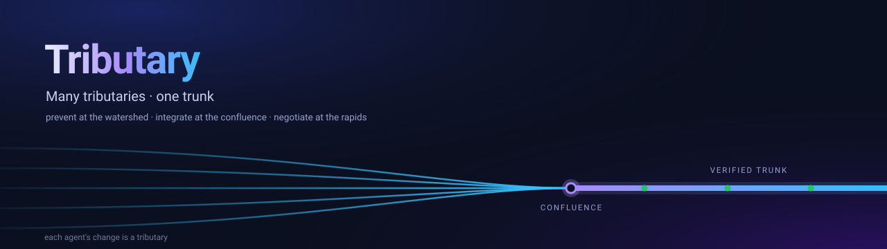

# Tributary



A coordination layer for many AI agents working on one codebase — currently
aimed at Vultr's Agent Rush Challenge 1, "Blast Radius Zero," with the
Cloudflare "Build the next GitHub" runtime kept as an alternate.

**Many tributaries, one trunk — zero blast radius.** Every agent's change is a
**tributary**: it is declared at the **watershed**, joins the trunk at the
**confluence**, and only the residual reaches the **rapids**. For Vultr Agent
Rush the pitch is fleet-level containment: not just "one run is sandboxed," but
"many agents can edit one repo without overlapping work, broken merges, or
unverified trunk landings." The metaphor is the architecture — the three
stages below are named for it.

**Thesis: conflicts are a scheduling problem first and a negotiation problem
last.** Tributary inverts the PR model: there are no pull requests. The unit of
work is a _change with a declared footprint_, continuously integrated through
three stages:

1. **Watershed (prevent).** Before starting, an agent declares the files it
   intends to touch. A Durable Object claim registry partitions that flow:
   non-overlapping claims are granted, overlapping ones are queued, and claims
   expire via TTL so crashed agents never hold locks.
2. **Confluence (integrate).** Each task works in its own forked Cloudflare
   Artifacts repo with a short-lived write token. Finished changes enter a
   sequential speculative merge queue — the confluence where tributaries join
   the trunk (rebase onto trunk, run tests, advance a verified trunk only when
   green).
3. **Rapids (negotiate).** Only changes that clear stages 1–2 and still
   conflict reach an LLM resolver agent — a last resort, not the core path.

## Architecture

| Piece            | Cloudflare primitive                      | Role                                                                                                                                                                                                                                        |
| ---------------- | ----------------------------------------- | ------------------------------------------------------------------------------------------------------------------------------------------------------------------------------------------------------------------------------------------- |
| `ClaimRegistry`  | Durable Object, SQLite (`src/index.ts`)   | File locks, waitlist, TTLs, live stats; row-level writes + a file→agent overlap index                                                                                                                                                       |
| Task repos       | Artifacts (`env.ARTIFACTS`)               | Import trunk, fork per task, scoped `write` tokens with TTL                                                                                                                                                                                 |
| `LocalArtifacts` | Durable Object (`src/artifacts-local.ts`) | Offline stand-in for the Artifacts surface above — import / fork / token / commit / merge on one shared `MemoryFS` git store. What the **default config** runs                                                                              |
| `MERGE_QUEUE`    | Workers Queue (`max_concurrency = 1`)     | Serializes speculative merges onto trunk                                                                                                                                                                                                    |
| Merge engine     | `src/merge.ts`                            | Three-way `isomorphic-git` merge + test gate; trunk only moves when green                                                                                                                                                                   |
| Resolver         | `src/resolver.ts` + Workers AI / Vultr    | Real LLM resolution via `@cf/meta/llama-3.1-8b-instruct-fast` under Wrangler or Vultr Serverless Inference under Node; per-file AI call; GitLab-Duo staged-commit model (write token minted only on approval)                               |
| Dashboard        | Worker `GET /` (`src/dashboard.ts`)       | Live console over SSE: river of active changes, trunk state, counters, claims, waitlist, feed, `?replay`                                                                                                                                    |
| `tributary` CLI  | `scripts/tributary.ts`                    | Agent-facing surface: `claim / fork / commit / release / run` in one script                                                                                                                                                                 |
| Built-in agent   | `src/agent.ts`                            | The C1 loop: goal → model plans + writes the diff (via the `ai` binding) → claim → fork → commit → queue. A client of the same surfaces external agents use                                                                                 |
| Task registry    | `ClaimRegistry` tasks table               | Product-level entities — `POST /tasks` dispatches one; lifecycle statuses plus plan, edits, commit, sandbox-gate evidence and resolution ride the SSE snapshot                                                                              |
| `tributary` MCP  | `scripts/mcp.ts`                          | MCP stdio server: `claim / release / status / commit / conflict` for agents                                                                                                                                                                 |
| Node/Vultr entry | `server/index.ts` + `server/env-node.ts`  | Runs the same Worker module under plain Node: node:sqlite for `ctx.storage.sql`, an in-process serial drain for `MERGE_QUEUE`, direct singleton instances for the DO classes, `cloudflare:workers` satisfied via a `registerHooks` shim     |
| Sandbox gate     | `server/sandbox.ts`                       | The containment layer: each merged tree's checks run in a throwaway container (`--network none`, read-only mount, no capabilities, 256MB/0.5CPU/pids caps, destroyed after the run) — the "production shape" the fixture gate stands in for |
| Vultr inference  | `server/vultr-ai.ts`                      | OpenAI-compatible adapter over `api.vultrinference.com/v1` presenting the `ai.run()` surface the resolver expects                                                                                                                           |

### HTTP surface (spike)

- `POST /tasks` — dispatch an agent task: `{goal, footprint?, edits?}`. The
  built-in agent plans the change with the inference model (or uses supplied
  `edits`), claims the footprint, forks, commits and hands off to the
  confluence. Lifecycle: `planning → claiming → queued → working → merging →
landed | rejected | failed`, with `resolving` in between on rejections
- `GET /tasks` · `GET /tasks/:id` — task records with plan, edits, commit,
  sandbox-gate evidence and resolution
- `GET /config` — which providers are live (`mode`, `sandbox`, `ai`); the
  topbar renders these as badges so the Vultr services in play are explicit
- `POST /demo/pack` — dispatch three preset tasks (clean / same-line
  conflict / broken code) so the full arc plays in-browser with no key
- `GET /` — live dashboard (streams `/registry/events`; `?replay` scrubs the
  retained event log). Task composer + task cards + a detail drawer showing
  the containment boundary per task
- `POST /import` — import upstream repo into Artifacts as trunk (`ejs-trunk`)
- `POST /fork` — fork trunk into a task repo, mint a 1h write token
- `POST /commit` — commit + push to a task repo via `isomorphic-git` on an
  in-memory FS, then enqueue a merge
- `POST /registry/claim` · `POST /registry/release` · `GET /registry/status`
- `GET /registry/events` — Server-Sent Events: `snapshot` on connect, `update`
  on every change, `: ping` every 15s (each frame is the `/registry/status`
  body)
- `GET /registry/replay` — the full retained event log, oldest first
- `POST /demo/conflict` — triggers a footprint-violation → resolver beat
  for the demo (no second Artifacts repo required)

## Run it

Prerequisites: Node ≥ 20. **No Cloudflare account is required** — the default
`wrangler.toml` runs fully offline against the in-worker Artifacts shim
(`src/artifacts-local.ts`). Cloudflare Artifacts itself is a remote-only
binding: it has no local simulator and requires a Workers **paid** plan, so a
Worker that declares it will not boot on a free account (see DECISIONS.md).

```sh
npm install        # also wires lint-staged/husky hooks + the TS6 lint shim
npm run dev        # terminal 1: wrangler dev at http://127.0.0.1:8787
npm run simulate   # terminal 2: spawn 5 concurrent agents at the endpoints
npm test           # optional: merge-engine harness + Node-env queue regression
open http://127.0.0.1:8787/   # live dashboard
```

## Node/Vultr mode (primary runtime)

The same Worker module also runs under plain Node — this is the Vultr
deployment. `server/index.ts` serves `worker.fetch` over `node:http`;
`server/env-node.ts` builds the same `Env` the Worker expects from
Vultr-side implementations. `wrangler dev`/`wrangler deploy` keep working
untouched as the Cloudflare alternate.

```sh
npm run dev:node   # same app, no Cloudflare — http://127.0.0.1:8787
API_BASE=http://127.0.0.1:8787 npm run simulate
```

Environment variables:

| Var                       | Default                                    | Meaning                                                                                                                                  |
| ------------------------- | ------------------------------------------ | ---------------------------------------------------------------------------------------------------------------------------------------- |
| `PORT` / `HOST`           | `8787` / `0.0.0.0`                         | Listen address                                                                                                                           |
| `TRIBUTARY_DB`            | `.tributary-state.db`                      | node:sqlite path backing the claim registry (`:memory:` for ephemeral)                                                                   |
| `VULTR_INFERENCE_API_KEY` | unset                                      | Enables the rapids' LLM resolver via Vultr Serverless Inference; without it resolutions fall back to deterministic yield-to-trunk        |
| `VULTR_INFERENCE_MODEL`   | `vultr/glm-5.3-flash`                      | Model id from `GET /v1/models`                                                                                                           |
| `TRIBUTARY_SANDBOX`       | auto (`docker` if available, else `local`) | `docker` = throwaway container per gate; `local` = isolated child process with empty env (dev fallback); `off` = in-process fixture gate |
| `SANDBOX_IMAGE`           | `node:22-alpine`                           | Image each gate container is created from                                                                                                |

**Containment.** With `TRIBUTARY_SANDBOX=docker`, every merge's gate runs
inside a fresh container: `--network none`, read-only mount, `--cap-drop
ALL`, `no-new-privileges`, 256MB memory / 0.5 CPU / 64-pid caps, `--rm` after
the run. Agent-influenced code is compiled and checked where it can never
reach the host, the control plane's secrets, or the network — and the
container is destroyed either way. A rejected merge rewinds trunk and routes
to the rapids, so the feed shows `claim → merge → sandbox reject → resolver`
when an agent ships broken code.

### Vultr Agent Rush positioning

Challenge 1 asks for a web-based agent that does real work inside a Vultr
sandbox and returns verifiable output. Tributary's differentiated answer is
that the dangerous part is not only executing code — it is **many agents
editing the same repo at once**. The product story is therefore:

> Tributary is the merge control plane for agent swarms: it schedules
> conflicting work before it starts, integrates changes serially, and proves
> the merged tree in a disposable Vultr sandbox — many agents, one trunk, zero
> blast radius.

Rubric fit:

- **Application of Technology** — Vultr Serverless Inference plans edits and
  resolves residual conflicts; Docker executes the merged-tree gate;
  `isomorphic-git` performs real three-way merges; task records carry gate
  evidence.
- **Presentation** — live dashboard with claims, waitlist, river, task cards,
  sandbox evidence, and SSE feed; deterministic `/demo/pack`.
- **Business Value** — teams running multiple coding agents on one repo need
  conflict scheduling and verified merges; Tributary reduces wasted agent
  compute, prevents broken trunk landings, and produces auditable merge
  evidence.
- **Originality** — "conflicts are a scheduling problem first and a negotiation
  problem last" is a different frame from the crowded single-run sandbox
  products in the current field.

Current gap to close before submission: the sandbox gate contains and checks
the merged tree, but it still needs to run a real verification command
(tests/script) and return stdout/stderr/exit code as product output. The demo
should also include a visible containment probe through the same sandbox path.
See `docs/VULTR_SUBMISSION.md` for the submission-aligned version.

### Deploying on Vultr

`deploy/setup-vultr.sh` provisions a fresh Cloud Compute VM (Docker + Node
22 + systemd unit on :8787); `deploy/docker-compose.yml` runs the control
plane as a container with the host's Docker socket mounted so the gate can
spawn sibling sandboxes. Then set `VULTR_INFERENCE_API_KEY` in
`/etc/tributary.env` for the resolver's LLM calls.

The claim registry is SQLite-backed. If `wrangler dev` refuses its storage on a
first run after pulling a storage change, clear local state and retry:
`rm -rf .wrangler/state`.

`npm run simulate` checks the pipeline rather than only printing logs: all
five agents must get a claim, an overlapping claim must be refused and
queued, and every task must pass through the serial confluence — it exits
non-zero otherwise.

The run shows the watershed granting non-overlapping agents immediately and
queueing overlapping ones (the queued tributary is promoted automatically when
the holder releases), then the confluence consuming tasks one at a time. Each
task is a real three-way `isomorphic-git` merge that only advances trunk when
the merge and the test gate both pass. The demo pack's two `src/index.js`
tasks are prepared before either merge is enqueued, so they fork the same
pre-merge trunk and surface a real same-line conflict for the rapids.

The loop closes: the resolver gets both sides of each conflicted file
(captured at merge time — `abortOnConflict` means conflict markers never reach
the task repo), produces resolved content, and the task re-enters the queue
once with that resolution attached. The retry merge applies it through
isomorphic-git's `mergeDriver`, producing a real merge commit the same test
gate re-verifies before trunk moves. You can watch the whole arc —
queued → promoted → conflict → resolved → landed — in the event feed.

### Workers AI is the one remote binding under Wrangler

`wrangler.toml` ships an optional `[ai]` binding, used only by the resolver.
AI bindings always run remotely — `wrangler dev` reports the mode as `remote`
and warns that they may incur charges even locally — but the resolver degrades
gracefully: if the model call fails it falls back to a deterministic
"yield to trunk" resolution (the conflicting file keeps trunk's version; the
task's other files still land). For a strictly offline run, delete the `[ai]`
block; nothing else changes. In Node/Vultr mode the same `ai.run()` surface is
provided by `server/vultr-ai.ts` instead, so the resolver/planner can use
Vultr Serverless Inference without changing Worker code.

### Drive it as an agent

`scripts/tributary.ts` exposes the lifecycle so a real agent — or a human — can
run it without hand-rolled HTTP:

```sh
npm run tributary -- --help
npm run tributary -- claim src/auth.ts
npm run tributary -- status
npm run tributary -- run src/auth.ts src/db.ts
```

Or over MCP (`scripts/mcp.ts`), so an agent can drive the same lifecycle
natively:

```sh
npm run mcp   # claim / release / status / commit / conflict
```

### Running against real Artifacts (paid plan)

Add the block below to `wrangler.toml` and drop the `LOCAL_ARTIFACTS` binding
and its `v2` migration. `src/index.ts` prefers `env.ARTIFACTS` automatically —
no source changes:

```toml
[[artifacts]]
binding = "ARTIFACTS"
namespace = "default"
remote = true
```

## Current status

What works end-to-end:

- ✅ Import / fork / tokenized-push pipeline, exercised end-to-end via
  `npm run simulate` (default offline provider: `src/artifacts-local.ts`)
- ✅ Claim registry DO with overlap detection, waitlist, TTL, metrics
- ✅ Queue-driven merge pipeline (`max_concurrency = 1`)
- ✅ **Real** three-way merge engine (`src/merge.ts`) with four outcomes
  (merged / already-merged / conflict / failed), a test gate, **and a
  semantic gate** — an acorn-based arity check that catches the conflict
  class git can't see (signature change in one file breaking a caller in
  another). Agent-Echo in `npm run simulate` exercises it every run.
- ✅ Queue consumer pre-filters footprint violations before spending a merge
- ✅ Dashboard streams over SSE — no polling: trunk state with the last landed
  commit, a three-stage pipeline named for the metaphor (watershed → confluence
  → rapids), active claims, waitlist, and a flow feed driven by the registry's
  own activity log. A live river draws one stream per active change converging
  at the confluence, waitlisted agents parked behind a watershed gate, and
  landed commits as nodes on the trunk; `?replay` scrubs the retained event
  log. It falls back to polling `/registry/status` every 1.5s if SSE errors.
  On a fresh start it shows the next command to run and a button that triggers
  the resolver beat in-page — no `curl` needed.
- ✅ Merge engine unit-tested via `npm test` — five merge cases (clean merge,
  real conflict, no-op re-merge, gate failure, and a semantic
  signature-change conflict) plus the Node-env queue regression
- ✅ `npm run simulate` is self-checking and exits non-zero if the pipeline
  did not actually run — verified on both `wrangler dev` and `dev:node`
- ✅ Node/Vultr runtime (`npm run dev:node`): same Worker module over
  `node:http`, sqlite-backed registry, serial in-process merge drain,
  task API, sandbox-gate evidence, and `/demo/pack` all verified locally
- ✅ **Real** LLM resolver (`src/resolver.ts`): receives both sides of each
  conflicted file from the merge engine, resolves via Workers AI under
  Wrangler or Vultr Inference under Node (or a deterministic yield-to-trunk
  fallback), and hands the resolved contents back to the queue — the retried
  merge applies them via `mergeDriver` and re-verifies through the test gate
  before trunk moves. One retry max. Also retains a staged-privilege clone
  path (read token → parse markers → write token on approval) for remote
  repos. Triggerable via `POST /demo/conflict`.
- ✅ `tributary` CLI (`scripts/tributary.ts`): agent-facing surface for
  `claim / release / status / fork / commit / conflict / run` — a real agent
  can drive the full lifecycle with `npm run tributary -- run <files...>`

What's still simulated or unverified:

- ⚠️ `env.ARTIFACTS` path is untested against a live namespace — this
  account is free tier and Artifacts requires a paid plan. The offline shim
  is what the default config and the simulation exercise.
- ⚠️ The Docker sandbox provider is implemented for the Vultr VM but was not
  exercised on a Docker host in the latest local pass — verification used
  `TRIBUTARY_SANDBOX=local` because Docker is not installed on the dev
  machine. Vultr Inference was likewise unconfigured, so AI paths used their
  deterministic fallbacks.
- ⚠️ The sandbox gate is real containment, but it currently compiles/checks
  the merged tree rather than executing the agent's code and returning
  stdout/stderr as product output. Challenge 1 needs that executed-work proof
  (repo tests or a verify script inside the same container) plus a visible
  containment probe.
- ⚠️ Resolutions are whole-file (both sides' full content, one AI call per
  file), not per-hunk. Fine for the fixture; a real tree would want hunk-level
  granularity. In Node/Vultr mode the merged tree is materialized into a
  throwaway container and checked there (`server/sandbox.ts`); the remaining
  Challenge-1 gap is executing a real verification command inside that same
  container and returning stdout/stderr as product output. The in-process semantic gate is a real AST check but
  scope-limited: exported-function arity across the merged tree,
  bare-identifier calls only — the production shape is the repo's own
  toolchain (tsc, eslint, test suite) in the same sandbox.
- ⚠️ `trunkStatus` reflects trunk health only — rejected merges increment
  `rejections` and invoke the resolver but never land, so trunk stays green
  by construction. Watch the `rejections` counter for rejection volume.

Known assumptions and doc findings are logged in [DECISIONS.md](./DECISIONS.md).

## Prior art

No existing system combines prevention, isolation, and a speculative merge
queue: [openorchestrator](https://github.com/gitpcl/openorchestrator) warns on
worktree overlap but never enforces; [weave](https://github.com/ataraxy-labs/weave)
resolves semantic conflicts reactively at merge time with no scheduling;
[openagents](https://github.com/openagents-org/openagents) coordinates agents
conversationally, not via code ownership; GitLab's Duo conflict resolver
([work item #20688](https://gitlab.com/groups/gitlab-org/-/work_items/20688))
validates LLM-resolver-as-last-resort but stays MR-centric. Tributary's thesis —
scheduling first, negotiation last — is the gap between them. Details in
[DECISIONS.md](./DECISIONS.md).

## Safety toolchain

ESLint + Prettier + husky hooks: `pre-commit` runs a gitleaks staged secret
scan and lint-staged; `pre-push` runs `tsc` + ESLint. Note: typescript-eslint
does not support TypeScript 7 yet, so linting uses a side-by-side TS 6 shim
(`scripts/link-ts6-for-eslint.mjs`, see DECISIONS.md).

## License

MIT
